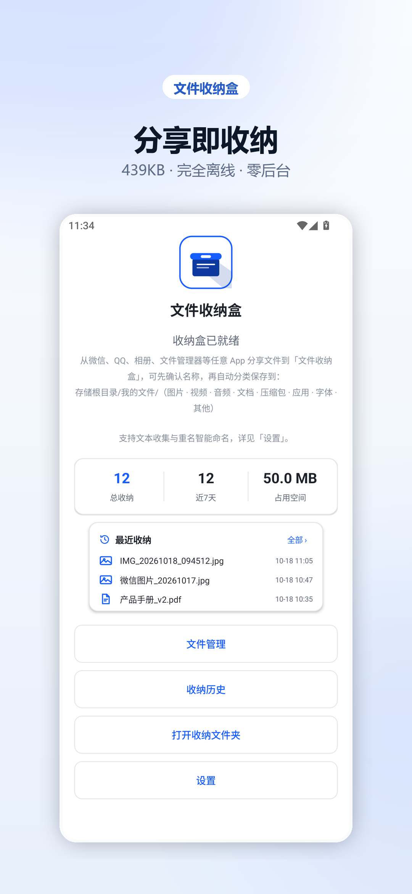
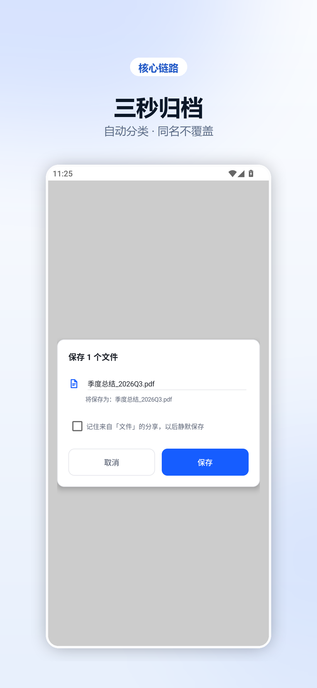
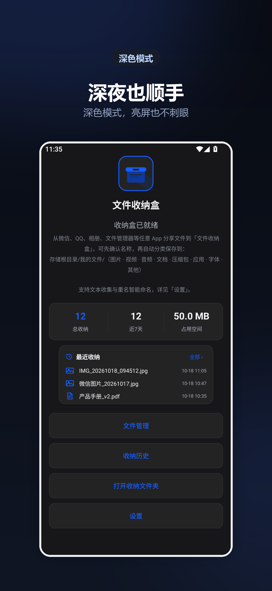
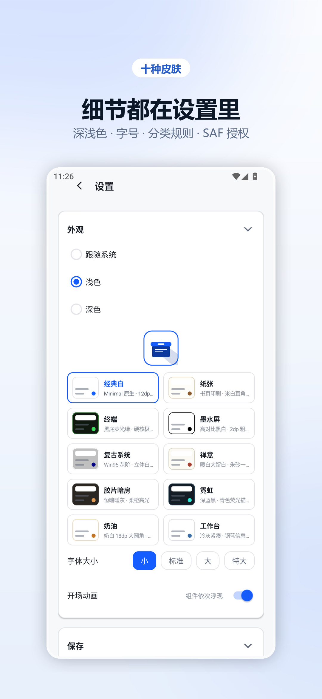
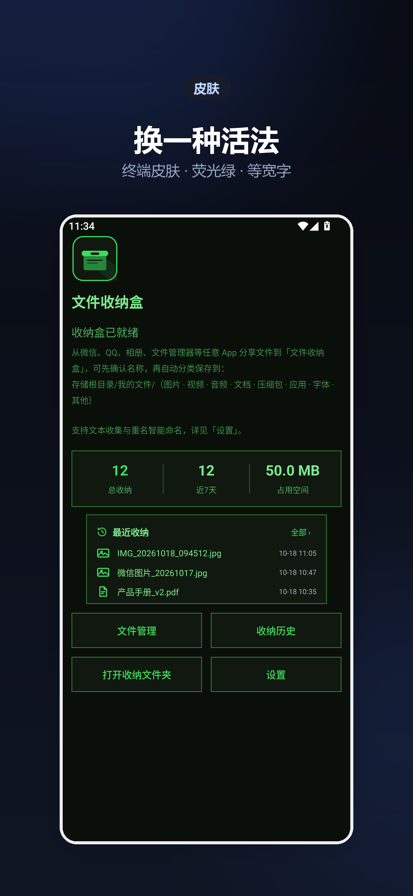
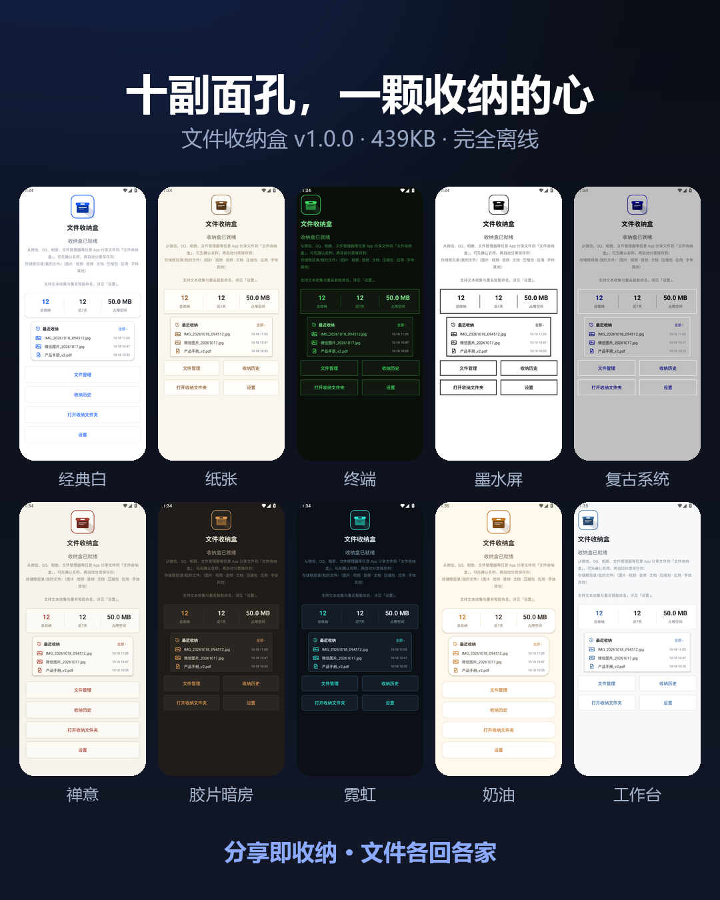

# 文件收纳盒 · FileBox

> 分享即收纳：手机文件自动分类归档，439KB 极简存在。

**v1.0.0 Spark** ｜ Android 7.0+（minSdk 24）｜ 439 KB ｜ 完全离线 ｜ 无网络权限 ｜ 无广告无追踪

<p>
  <a href="https://github.com/YanXi20110914/filebox/releases/download/v1.0.0/FileBox_v1.0.0_release.apk"><b>⬇ 下载 APK（439KB）</b></a>
  &nbsp;·&nbsp;
  <a href="https://yanxi20110914.github.io/filebox/">在线主页</a>
  &nbsp;·&nbsp;
  <a href="https://www.axureshow.com/project/9sm6pBaV/">镜像预览（国内）</a>
</p>



---

## 你的手机文件，值得一间整洁的房间

截图、文档、安装包、压缩包……每一次"下载"都在给存储空间添堵。文件收纳盒只做一件事：**让你顺手把文件放对地方**。

### 1. 分享即收纳
在微信、浏览器、文件管理器里点"分享"，选择文件收纳盒——自动识别文件类型，归入对应分类目录（图片 / 文档 / 视频 / 音频 / 安装包 / 压缩包 / 字体 / 其他），全程不超过 3 秒。

### 2. 十种界面皮肤
经典白、纸张、终端、墨水屏、复古系统、禅意、胶片暗房、霓虹、奶油、工作台——每种皮肤不止换配色：布局重排、桌面图标联动、专属 3D 开场动画，连状态栏都跟着换装。

### 3. 文本速记
微信里看到一段有用的文字？分享给收纳盒，直接存成 `.txt` 笔记，自动进"文档"分类。

### 4. 智能命名防覆盖
同名文件不覆盖：跨年自动补年份、同年补日期、同日补时分秒——文件再多也永不丢失。

### 5. 全局搜索 + 历史
按名称、分类、来源、时间筛选所有收纳记录；支持星标与备注，重要文件一眼定位。

### 6. 空间统计
直观展示各分类占用，存储剩余不足 20MB 自动预警，拒绝半截文件。

### 7. 你的文件只属于你
- 无广告、无开屏、无任何追踪
- **不申请网络权限**，物理级完全离线
- 推荐使用系统 SAF 授权（免"所有文件访问"权限），最小权限原则
- 全部数据仅存本机，卸载即彻底删除

### 8. 极致轻量
安装包 **439KB**（一张照片的几分之一），运行零后台，不占通知栏常驻，不注册自启。

### 9. 适用场景
收藏图片归类 / 项目文档管理 / 安装包统一存放 / 微信文字收集 / 换机前文件整理 / 强迫症日常急救。

---

## 功能亮点

| # | 亮点 |
|---|---|
| 1 | **分享即收纳** — 系统分享面板直达，3 秒归档 |
| 2 | **智能分类** — 12 类自动识别 + 自定义规则 |
| 3 | **链式防覆盖命名** — 同名文件永不丢失 |
| 4 | **十种皮肤** — 布局 / 图标 / 开场动画全套换装 |
| 5 | **全局搜索** — 名称 / 分类 / 来源 / 时间四维筛选 |
| 6 | **星标 + 备注** — 重要文件打标记 |
| 7 | **空间统计** — 分类占用 + 低空间预警 |
| 8 | **SAF 免权限引擎** — 不索要"所有文件访问" |
| 9 | **完全离线** — 无 INTERNET 权限，物理级隐私 |
| 10 | **439KB** — 拒绝臃肿 |
| 11 | **文本速记** — 分享文字秒变笔记 |
| 12 | **批量收纳** — 多文件一次分享逐项处理 |

---

## 界面预览

| 分享即收纳 | 三秒归档 | 深夜模式 |
|---|---|---|
|  |  |  |

| 细节可调 | 终端皮肤 | 十款皮肤 |
|---|---|---|
|  |  |  |

真机截图（1080×2340）见 `images/raw_*.png`，宣传视频见 `video/promo_60s.mp4`。
商店文案完整版见 `docs/发布介绍_文件收纳盒_v1.0.0.md`。

---

## 权限说明

| 权限 | 用途 | 说明 |
|---|---|---|
| 网络 | — | **未申请**，APK 层面物理隔离 |
| 通知（可选） | 保存完成提醒 | 拒绝则静默跳过，不影响功能 |
| SAF 目录授权（可选） | 归档目标目录 | 系统级授权，仅限用户指定目录树 |
| 所有文件访问（可选） | 备用存储引擎 | 不授权则自动使用 SAF，功能完整 |

不申请：位置、通讯录、相机、麦克风、电话、短信、安装包列表。

## 隐私

本应用不收集、不传输、不共享任何用户数据。应用未申请网络权限，所有收纳记录、备注、偏好设置仅存储在设备本地私有目录，卸载即彻底删除。

---

## 仓库结构

```
FileBox/
├── apk/        FileBox_v1.0.0_release.apk     # 正式签名包
├── source/     FileBox_v1.0.0_src.zip         # Kotlin 源码（不含签名密钥）
├── images/     商店图 / 真机截图 / 十皮肤海报
├── video/      promo_60s.mp4                  # 60 秒宣传片
└── docs/       商店文案完整版
```

## 在线主页与镜像

- GitHub Pages：<https://yanxi20110914.github.io/filebox/>
- 国内镜像（AxureShow）：<https://www.axureshow.com/project/9sm6pBaV/> —— 该页同样**内嵌了 APK**，点「下载」直接保存
- 离线单文件版：`docs/index.html` 即镜像页本体，双击本地打开也能下载安装包

## 签名

正式发布签名（RSA 2048，有效期 25 年，`CN=YanXi`）。升级安装须使用同一密钥，签名库不随源码分发。

---

开发者：**晏席** ｜ 包名 `com.filebox.collect` ｜ 版本 1.0.0 (42)
